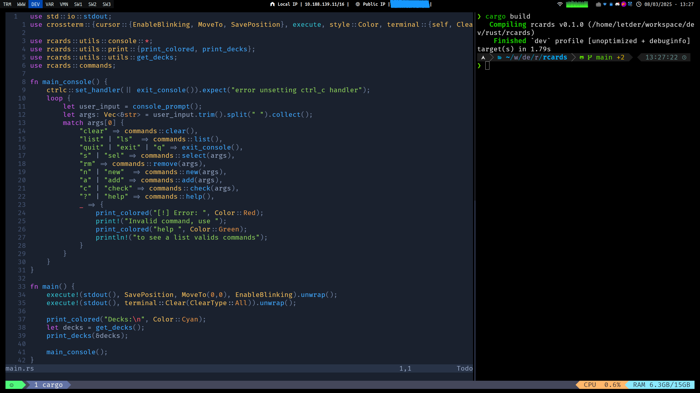

# Letder's Neovim config

My custom neovim config

# Features

## Main plugins

- plugin mannager: lazy

- lsp
  - mannager: mason
  - cmp: blink

- file explorer
  - telescope (navigation)
  - oil (in-buffer file mannager)

- colorscheme: onedark

## other plugins:

- better-diagnostic
- harpoon
- zen

checkout [my dotfiles](https://github.com/Letder40/Dotfiles) if you want to try my optimized workflow with one command
